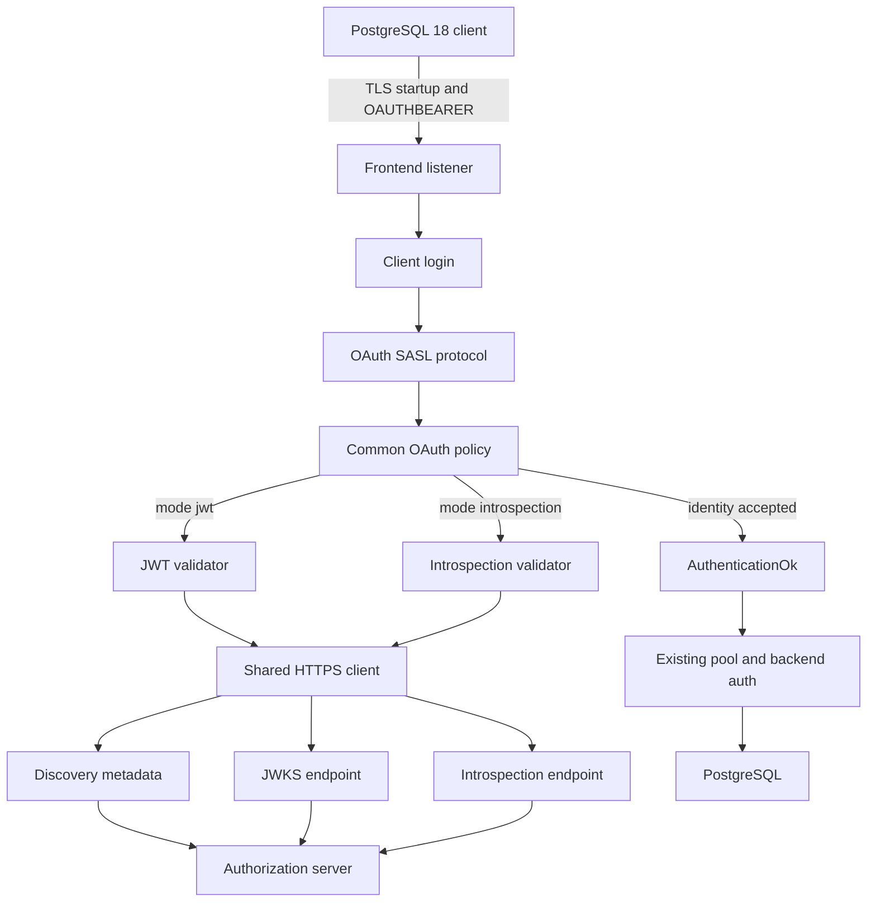
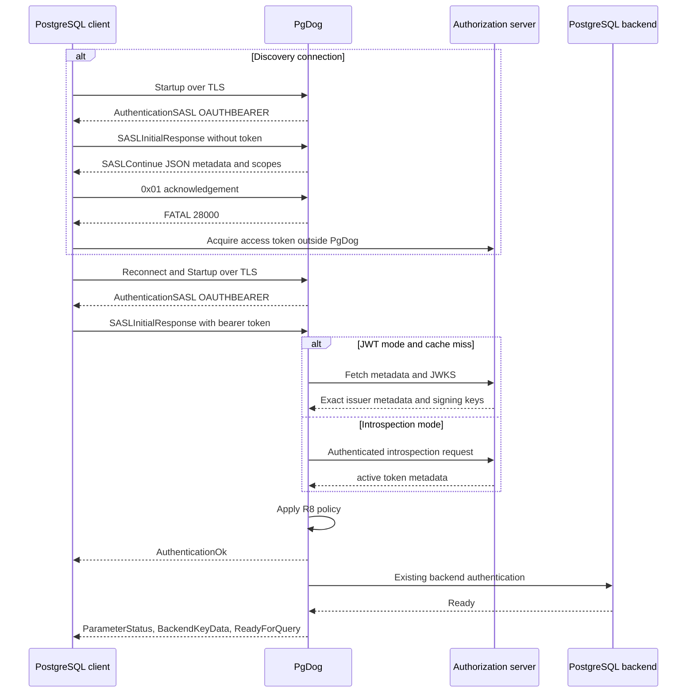
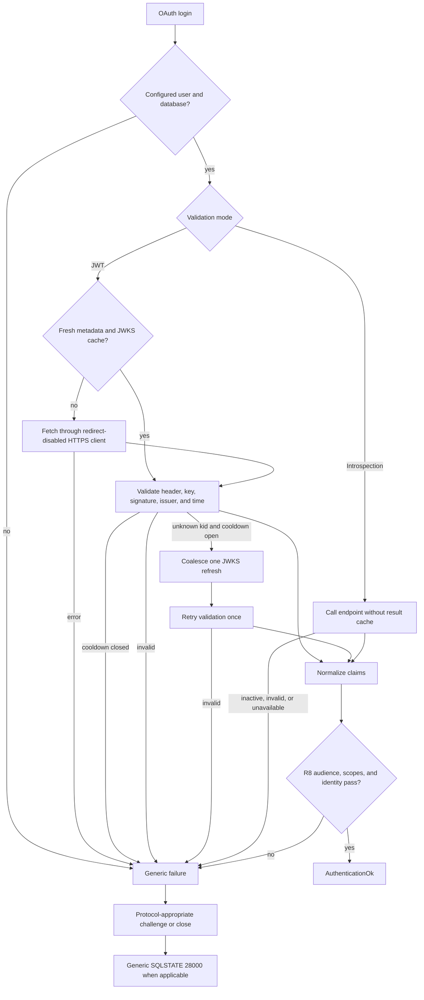

# Client OAuth Authentication - Plan

## Goal Capsule

- **Objective:** Let PostgreSQL clients authenticate to PgDog with SASL `OAUTHBEARER`, using either local JWT validation through OIDC discovery and JWKS or remote RFC 7662 token introspection.
- **Authority:** The Product Contract defines behavior.
  The Planning Contract defines implementation choices within that behavior.
  PostgreSQL 18 protocol documentation, RFC 7628, RFC 7662, RFC 6750, RFC 8414, OpenID Connect Discovery, and RFC 8725 govern standards behavior.
- **Execution profile:** Implement six dependency-ordered units as one security-sensitive feature.
- **Stop conditions:** Stop rather than guess if an implementation choice would weaken TLS, issuer, audience, scope, identity, signature, secret-handling, or fail-closed requirements.
  Stop if PostgreSQL 18 `libpq` interoperability cannot be demonstrated.
- **Tail ownership:** The implementation owner updates generated schema and documentation, runs all Verification Contract gates, removes abandoned code, and resolves CI regressions before handoff.

---

## Product Contract

### Summary

PgDog will act as the OAuth server endpoint in the client-to-PgDog PostgreSQL connection.
For normal users not already authenticated by the existing mTLS identity path, it will advertise PostgreSQL 18 SASL `OAUTHBEARER`, receive a bearer access token, and authenticate the requested PgDog username against a configured top-level token claim.
Operators will choose one validation mode: local signed-JWT validation with discovery and JWKS, or remote RFC 7662 introspection.
PgDog-to-PostgreSQL authentication remains independent and unchanged.

### Problem Frame

PgDog currently authenticates frontend clients with trust, passwords, SCRAM-SHA-256, plaintext passwords, or mTLS.
Applications that already use an OAuth authorization server cannot present an access token directly to PgDog.
Issue [#831](https://github.com/pgdogdev/pgdog/issues/831) identifies PostgreSQL OAuth support, but its original PgDog-to-PostgreSQL direction does not address this client-facing need.
This plan applies OAuth at the frontend authentication boundary instead.

### Actors

| ID | Actor | Responsibility |
|---|---|---|
| A1 | PgDog operator | Configures TLS, OAuth policy, users, and backend credentials. |
| A2 | PostgreSQL client | Uses PostgreSQL 18 OAuth support or an equivalent `OAUTHBEARER` implementation to discover metadata and present an access token. |
| A3 | PgDog frontend | Runs the SASL exchange, validates the token, and admits or rejects the requested user and database. |
| A4 | Authorization server | Publishes metadata and JWKS or answers authenticated introspection requests. |
| A5 | PostgreSQL backend | Accepts PgDog connections through the existing backend authentication configuration. |

### Key Flows

- F1. OAuth configuration and startup
  - **Trigger:** A1 starts or reloads PgDog with `general.auth_type = "oauth"`.
  - **Actors:** A1, A3
  - **Steps:** PgDog validates the OAuth section, TLS posture, mode-specific fields, URLs, algorithms, timeout bounds, CA file, and introspection secret source before accepting the new configuration.
  - **Outcome:** New client connections use one valid OAuth policy and runtime generation, or OAuth preparation fails without publishing the candidate generation.
  - **Covered by:** R1, R2, R3, R4, R14, R18

- F2. Client discovery connection
  - **Trigger:** A2 selects `OAUTHBEARER` but sends no bearer token in the SASL initial response.
  - **Actors:** A2, A3
  - **Steps:** PgDog sends the PostgreSQL OAuth discovery JSON in `AuthenticationSASLContinue`, reads the required one-byte client acknowledgement, sends a generic authentication failure, and closes the connection.
  - **Outcome:** The client can acquire a token and reconnect without PgDog contacting a backend.
  - **Covered by:** R5, R6, R7, R12

- F3. Local JWT login
  - **Trigger:** A2 reconnects with an `OAUTHBEARER` access token while `oauth.mode = "jwt"`.
  - **Actors:** A2, A3, A4, A5
  - **Steps:** PgDog resolves the configured user and database, parses the SASL response, obtains trusted metadata and signing keys, validates the JWT and common policy, sends `AuthenticationOk`, and continues through the existing backend path.
  - **Outcome:** A valid token authenticates exactly one requested PgDog username.
  - **Covered by:** R5, R6, R8, R9, R11, R12, R13

- F4. Remote introspection login
  - **Trigger:** A2 sends an `OAUTHBEARER` access token while `oauth.mode = "introspection"`.
  - **Actors:** A2, A3, A4, A5
  - **Steps:** PgDog resolves the configured user and database, submits the token to the configured or discovered introspection endpoint with client authentication, applies the common policy, sends `AuthenticationOk`, and continues through the existing backend path.
  - **Outcome:** Only a currently active token with the required claims authenticates the requested PgDog username.
  - **Covered by:** R5, R6, R8, R10, R11, R12, R13

- F5. Authentication failure
  - **Trigger:** The SASL payload, token, provider response, configuration-derived metadata, or common policy is invalid.
  - **Actors:** A2, A3, A4
  - **Steps:** PgDog completes the protocol-required failure exchange when possible, records only a sanitized internal reason, emits one generic SQLSTATE `28000` client error, and closes the connection.
  - **Outcome:** PgDog never sends `AuthenticationOk`, opens a backend connection, falls back to a password mode, or exposes sensitive provider data.
  - **Covered by:** R6, R7, R8, R9, R10, R11, R12, R16, R17, R18, R19

### Requirements

**Configuration and compatibility**

- R1. `AuthType` accepts `oauth` as a global and exclusive frontend authentication mode through TOML, `PGDOG_AUTH_TYPE`, display output, and the existing admin `SET auth_type` path.
- R2. PgDog exposes one optional top-level `[oauth]` section with the field contract below.
- R3. OAuth activation requires `general.tls_client_required = true`, a readable frontend certificate and private key, disabled passthrough, and complete mode-specific configuration before the candidate becomes active through startup, reload, environment, or admin `SET` paths.
  Validation rejects unsafe bounds, including `clock_skew` above `300000` milliseconds, before publication.
  PgDog cannot enforce client certificate verification, so U5 and U6 require production OAuth clients to verify the PgDog certificate chain and hostname.
- R4. `md5`, `scram`, `plain`, `trust`, passthrough, and mTLS behavior remains unchanged when OAuth is not selected.

#### OAuth configuration contract

| Field | Applies to | Contract |
|---|---|---|
| `mode` | Both | Required enum: `jwt` or `introspection`; PgDog never falls back between modes. |
| `issuer` | Both | Required HTTPS issuer URL; metadata and token issuer comparisons use exact string equality. |
| `audience` | Both | Required non-empty audience; a string or array token claim must contain this exact value. |
| `scopes` | Both | Required non-empty list; every configured scope must be present in the normalized token scopes. |
| `identity_claim` | Both | Optional top-level string claim name; defaults to `sub`; nested claim paths and alias maps are unsupported. |
| `discovery_url` | Both | Optional HTTPS override; otherwise derive the OpenID Provider Configuration URL from `issuer` according to OpenID Connect Discovery. |
| `http_timeout` | Both | Optional positive aggregate OAuth HTTP deadline per login in milliseconds; defaults to `5000` and must be less than `general.client_login_timeout`. |
| `clock_skew` | Both | Optional time-validation leeway in milliseconds; defaults to `60000` and must not exceed `300000`. |
| `ca_certificate` | Both | Optional path to a PEM CA bundle for a private authorization server; native roots remain the default. |
| `max_concurrent_requests` | Both | Optional positive process-wide concurrent OAuth validation limit; defaults to `64`. |
| `algorithms` | JWT | Optional non-empty asymmetric JWT algorithm allowlist; defaults to `RS256`; HMAC and `none` are forbidden. |
| `jwks_uri` | JWT | Optional exact HTTPS override used instead of the discovered JWKS URI; its origin is explicitly operator-authorized under R16. |
| `jwks_cache_ttl` | JWT | Optional positive duration in milliseconds; defaults to `300000`. |
| `introspection_endpoint` | Introspection | Optional HTTPS override used instead of the endpoint from authorization-server metadata. |
| `client_id` | Introspection | Required client identifier for HTTP Basic client authentication. |
| `client_secret_file` | Introspection | Optional path to a secret file; if absent, use `PGDOG_OAUTH_CLIENT_SECRET`; exactly one non-empty source must resolve during startup or reload. |

**Wire protocol and terminal behavior**

- R5. OAuth login advertises only `OAUTHBEARER` and implements PostgreSQL 18 discovery, token-bearing, success, and failure exchanges without sending `AuthenticationSASLFinal` on success.
- R6. The active authentication state interprets exact password-message payload bytes as a null-terminated password, SASL initial response, or SASL response without C-string inference.
- R20. OAuth accepts the GS2 `n,,` form, optional unique `host` and `port` fields, exactly one `auth=Bearer` field, and the terminal separator while rejecting non-empty `authzid`, duplicates, unknown fields, embedded NULs, and trailing bytes.
- R7. OAuth credential failures use the RFC 7628 JSON challenge and one-byte acknowledgement when the exchange is structurally valid, then send one generic SQLSTATE `28000` error and close; malformed PostgreSQL frames follow the existing protocol-error close path.

**Token validation and security**

- R8. Both modes require the configured audience, every configured scope, and a string `identity_claim` that exactly equals the startup username; time claims and issuer evidence are checked as defined by the selected mode.
- R9. JWT mode accepts only signed JWT access tokens with a required `exp`, exact `iss`, allowed `alg`, one compatible trusted JWK, valid signature, valid time window, and the common policy from R8.
- R10. Introspection mode requires an authenticated RFC 7662 response with `active = true`, rejects invalid supplied `exp`, `nbf`, or `iss`, requires audience and identity data for R8, and does not cache authorization results.
- R11. OAuth HTTP calls in one login share the aggregate `http_timeout` deadline and use TLS certificate verification, disabled redirects, and disabled ambient proxies; tokens, client secrets, full claims, and provider response bodies never enter logs or client errors.
- R16. Every metadata or token-bearing endpoint must use the issuer origin unless the operator configured that endpoint's exact HTTPS URL through `discovery_url`, `jwks_uri`, or `introspection_endpoint`.
  URLs with credentials or fragments are rejected before any request carries a token or client secret.
- R17. PgDog rejects OAuth password frames above 128 KiB before body allocation, bearer tokens above 64 KiB, provider bodies above 1 MiB, JWKS sets above 128 keys, and excess concurrent OAuth validations.
  One process-wide limiter is shared by overlapping runtime generations and held from before token parsing through the final policy decision.
  Within that limit, one network peer IP may hold at most `min(8, max_concurrent_requests)` permits; attempts above either ceiling fail immediately before token parsing or provider access.
  Unknown-`kid` refreshes are coalesced and limited to one per provider cache generation within five seconds.
- R18. Serializable configuration stores only an introspection secret locator, while each immutable runtime generation holds one bounded, newline-normalized, redacted secret value that is never serialized or exposed through `Debug` or `Display`.
- R19. JWT key selection uses only the discovered JWKS and requires one unambiguous `kid` match with compatible signing use, verification operation, declared algorithm, key type, curve, and parameters.
- R21. JWT validation rejects token-supplied key URLs or embedded keys, duplicate registered claims, and conflicting `scope` and `scp` values.

**Login, backend, and reload lifecycle**

- R12. PgDog rejects an unknown `(user, database)` before contacting A4, preserves existing mTLS precedence, and applies OAuth to the configured admin username when `auth_type = "oauth"`.
- R13. OAuth frontend credentials never enter backend `Address` passwords or token caches, and an OAuth-authenticated user can launch a pool without a frontend password when existing backend configuration permits a PostgreSQL connection.
- R14. Each login captures one immutable configuration and OAuth runtime generation, and reload publishes a fully prepared generation atomically without allowing old in-flight work to populate it.
- R22. Established sessions are not revalidated or disconnected when a token expires, is revoked, or the OAuth policy changes.

**Operations and support**

- R15. The feature ships with sanitized reason-level logs, generated schema, operator documentation, PostgreSQL 18 interoperability coverage for both modes, and regression coverage for existing authentication modes; it adds no new metrics in this release.

### Scope Boundaries

**Included**

- Client-to-PgDog PostgreSQL SASL `OAUTHBEARER` authentication.
- OIDC discovery plus local JWT/JWKS validation.
- RFC 7662 introspection with HTTP Basic client authentication.
- One global OAuth policy and strict top-level claim-to-username binding.
- OAuth authentication for the PgDog admin database under the current global auth model.

**Deferred**

- Mixed OAuth and password users on one listener.
- Per-user issuers, audiences, scopes, aliases, or nested claim paths.
- Additional introspection client-authentication methods.
- Authorization-result caching, continuous session revalidation, and revocation-triggered disconnects.
- New frontend authentication metrics.

**Out of scope**

- PgDog-to-PostgreSQL OAuth, token acquisition, refresh tokens, and upstream OAuth configuration.
- Browser redirects, authorization-code flow, device flow, PKCE, client credentials, or any grant execution inside PgDog.
- Provider-specific adapters and custom validator plugins.
- Treating bearer tokens as database passwords.

### Acceptance Examples

- AE1. Discovery handshake
  - **Covers:** R5, R7
  - **Given:** OAuth mode is valid and a PostgreSQL 18 client starts `OAUTHBEARER` without a token.
  - **When:** PgDog receives an absent or empty SASL initial response.
  - **Then:** PgDog returns the configured discovery URL and scopes in the PostgreSQL JSON challenge, consumes `0x01`, sends generic SQLSTATE `28000`, and never contacts PostgreSQL.

- AE2. Valid JWT login
  - **Covers:** R8, R9, R12, R13
  - **Given:** The startup user is `app`, the configured identity claim is `sub`, and a trusted JWT has `sub = "app"`, the configured issuer, audience, scopes, and time window.
  - **When:** The client reconnects with that token.
  - **Then:** PgDog sends `AuthenticationOk` and uses only the pre-existing backend credential path to serve the connection.

- AE3. Valid introspection login
  - **Covers:** R8, R10, R11
  - **Given:** The introspection endpoint returns `active = true` with the required audience, scopes, and identity.
  - **When:** The client presents the opaque token.
  - **Then:** PgDog authenticates once and does not cache the authorization result.

- AE4. Identity, audience, or scope mismatch
  - **Covers:** R7, R8
  - **Given:** A token is otherwise valid but one required policy value is absent or differs.
  - **When:** PgDog evaluates the token.
  - **Then:** PgDog completes the OAuth failure exchange and reveals no failed claim or token content to the client.

- AE5. Unknown user or database
  - **Covers:** R12
  - **Given:** A client presents any token for an unconfigured `(user, database)` pair.
  - **When:** Login starts.
  - **Then:** PgDog rejects the connection before discovery, JWKS, or introspection network traffic occurs.

- AE6. JWT key rotation
  - **Covers:** R9, R11, R14, R17
  - **Given:** A valid token uses an unknown `kid` after the provider rotates keys.
  - **When:** The cached JWKS lacks that key.
  - **Then:** PgDog performs one forced refresh, accepts the token only if the refreshed trusted set validates it, and otherwise fails closed.

- AE7. Authorization server failure
  - **Covers:** R7, R10, R11
  - **Given:** Required metadata, JWKS, or introspection cannot complete before the inner HTTP timeout.
  - **When:** A new OAuth login depends on that call.
  - **Then:** PgDog fails the login within `client_login_timeout`, without a password fallback or stale authorization decision.

- AE8. OAuth-only frontend user
  - **Covers:** R13
  - **Given:** A configured user has no frontend password and has a valid independent backend credential or a backend that permits the connection.
  - **When:** PgDog launches pools and the user supplies a valid OAuth token.
  - **Then:** The pool remains enabled and the bearer token is never used upstream.

- AE9. Admin and reload semantics
  - **Covers:** R12, R14, R22
  - **Given:** An admin is connected and the operator reloads a changed valid OAuth policy.
  - **When:** Existing and new clients continue operating.
  - **Then:** The established admin session remains connected, and every later login uses the new policy and matching cache namespace.

- AE10. Existing authentication regression
  - **Covers:** R4, R15
  - **Given:** OAuth is not selected.
  - **When:** Existing MD5, SCRAM, plaintext, trust, passthrough, or mTLS tests run.
  - **Then:** Their wire behavior and credential handling are unchanged.

- AE11. Bounded hostile traffic
  - **Covers:** R6, R17, R19
  - **Given:** Clients concurrently send oversized frames or tokens, JWTs with random unknown key IDs, or invalid signatures against a cached known key.
  - **When:** OAuth login processes the attempts from one hostile peer and a second legitimate peer.
  - **Then:** PgDog rejects frames before oversized allocation, rejects attempts above the global or per-peer limit before provider access, preserves capacity for the second peer, bounds complete validation work and cache growth, and performs no more than the allowed coalesced JWKS refreshes.

- AE12. Failed reload preparation
  - **Covers:** R3, R14, R18
  - **Given:** PgDog has a working OAuth generation and a reload contains an unreadable CA, unreadable secret, invalid TLS material, or another preparation failure.
  - **When:** Reload runs while an OAuth validation request is in flight.
  - **Then:** The reload fails, the previous generation remains active, and the old request cannot mutate state visible to a later generation.

- AE13. Global OAuth cutover and rollback
  - **Covers:** R1, R3, R4, R14, R22
  - **Given:** A valid `[oauth]` section is pre-staged while a password mode is active and clients are already connected.
  - **When:** The operator activates OAuth with a valid reload and later reloads the prior authentication mode.
  - **Then:** Each successful reload changes only later logins, established sessions remain connected, and an invalid cutover or rollback candidate leaves the current generation active.

### Success Criteria

- PostgreSQL 18 `libpq` completes discovery and token-bearing connections through PgDog over TLS.
- Both validation modes pass positive, policy-negative, provider-failure, timeout, and reload tests.
- Existing frontend auth suites pass without changed password error text.
- No test, log, error, debug formatter, or backend credential object exposes a bearer token or introspection secret.
- Invalid OAuth configuration or runtime preparation never replaces an active valid configuration generation.
- Hostile token sizes, provider bodies, unknown key IDs, invalid signatures, and concurrent OAuth validation attempts stay within R17 bounds.

---

## Planning Contract

### Key Technical Decisions

- KTD1. **Implement OAuth only in the frontend login boundary** `(session-settled: user-directed — chosen over PgDog-to-PostgreSQL OAuth: the requested boundary is application-to-PgDog authentication.)`
  Extend `pgdog/src/frontend/client/mod.rs` and `pgdog/src/auth/` while leaving `pgdog/src/backend/server.rs` and upstream token acquisition unchanged.
  This realizes R12 and R13 without coupling bearer tokens to pooled server connections.

- KTD2. **Use one explicit validation-mode enum with no fallback** `(session-settled: user-directed — chosen over JWT-only validation: the first release must also support remote introspection.)`
  A configured login dispatches to JWT or introspection exactly once, then both implementations return normalized claims to the R8 policy gate.
  This avoids accepting a token under weaker secondary semantics after a primary validation failure.

- KTD3. **Preserve the global `general.auth_type` model and current login precedence** `(session-settled: user-approved — chosen over mixed per-user authentication: the first release should follow PgDog's current exclusive listener-wide behavior.)`
  Branch to OAuth separately from `Client::check_password` so an OAuth user does not require a configured frontend password.
  The authoritative OAuth login order is the table below; passthrough is unreachable because R3 rejects that combination.

| Order | Login action |
|---|---|
| 1 | Reject non-TLS connections before advertising SASL or reading a token. |
| 2 | Distinguish the configured admin target from normal users. |
| 3 | Resolve a normal `(user, database)` cluster and reject an unknown pair before provider I/O. |
| 4 | Preserve normal-user mTLS identity success and required-client-certificate rejection. |
| 5 | Run OAuth directly for the expected admin or cluster username without Vault or password resolution. |
| 6 | Complete a terminal generic failure or send `AuthenticationOk`. |
| 7 | Apply the existing shutdown gate, backend-parameter lookup, and client registration order. |

- KTD4. **Add narrow protocol and cryptography dependencies.**
  Use `jsonwebtoken` 11 with its `aws_lc_rs` feature for JWK decoding and signature validation.
  Use `oauth2` 5 with `default-features = false` for RFC 7662 request and response types, adapted to the workspace's `reqwest` 0.13 client.
  Do not add `openidconnect`, and verify that `oauth2` does not introduce `reqwest` 0.12.

- KTD5. **Publish all connection policy as one immutable runtime generation.**
  Add a process-wide `ArcSwap<LiveState>` owner in `pgdog/src/runtime.rs`; each `LiveState` contains the validated configuration, OAuth runtime, prepared databases, and TLS acceptor.
  Split `config::load`, `replace_databases`, and TLS reload into non-publishing preparation operations used by `prepare_reload(...) -> PreparedLiveState`.
  After every fallible step succeeds, `commit_reload(PreparedLiveState)` performs the only live-state swap; listener, login, and backend lookup retain one captured `Arc<LiveState>` instead of reacquiring separate globals.
  Prepare resolved CA bytes, a redacted introspection secret, a redirect-free and proxy-free HTTP client, and empty generation-owned caches before the commit.
  Namespace discovery and JWKS entries by issuer, discovery URL, and a fingerprint of resolved trust material; use the captured generation's TTL and never cache authorization decisions.
  After the commit, mark the prior snapshot's pools retired and shut them down when the last captured `Arc` is released; retirement cannot change the published state.

- KTD6. **Let authentication state interpret exact password-frame bytes.**
  The shared envelope parser validates the frame length and returns bytes without guessing message semantics.
  The active state then parses a null-terminated password, SASL initial response, or SASL response and performs mechanism-specific UTF-8 and grammar checks from R6.
  This fixes the common trust boundary once and preserves valid non-C-string SCRAM response payloads.

- KTD7. **Separate internal diagnosis from wire errors.**
  Add OAuth-specific `AuthResult` or OAuth error categories for sanitized logs, but use a dedicated generic OAuth `ErrorResponse` for clients.
  Do not alter the existing password-specific `ErrorResponse::auth` text because current tests and clients rely on it.

- KTD8. **Make pool launch eligibility independent of frontend password presence** `(session-settled: user-approved — chosen over requiring placeholder passwords: OAuth credentials must not be copied into backend authentication.)`
  Give each database generation the auth type from the configuration snapshot that constructed it, then treat global OAuth as sufficient frontend readiness while `Address::new` continues to derive only backend credentials.
  Backend trust, database passwords, `server_password`, and external server authentication remain valid without placing OAuth state in `Cluster`, `Address`, or the backend `TokenCache`.

- KTD9. **Use real PostgreSQL 18 `libpq` as the interoperability authority.**
  Unit tests own malformed frames and deterministic policy branches.
  A dedicated integration suite owns discovery, wire compatibility, TLS, provider interaction, key rotation, and successful SQL after login.

- KTD10. **Bound attacker-controlled OAuth work before allocation, parsing, cryptography, or provider access.**
  Use one process-wide `max_concurrent_requests` semaphore across overlapping runtime generations.
  Within the global ceiling, track active permits by network peer IP and reject a peer above `min(8, max_concurrent_requests)`.
  Acquire both permits before token parsing, signature verification, or introspection dispatch and hold them through the final policy decision.
  Enforce the fixed R17 frame, token, response, and JWK limits while coalescing cache fills and permitting one unknown-`kid` forced refresh per provider generation within five seconds.

### High-Level Technical Design

The diagrams show component boundaries and decisions, not exact Rust APIs.
KTD1 through KTD10 remain authoritative for implementation details.

### System-Wide Impact

| Surface | Impact | Guardrail |
|---|---|---|
| Frontend protocol | Adds `OAUTHBEARER` and stricter SASL initial-response framing. | Run existing SCRAM tests plus byte-level malformed-frame tests from U2. |
| Configuration | Adds `AuthType::OAuth` and `[oauth]`; reload can change security policy and trust material. | Prepare config, OAuth runtime, databases, and TLS before atomically publishing one generation under KTD5. |
| Authentication timing | JWT validation and every introspection login consume bounded work inside the login timeout. | One aggregate `http_timeout` deadline is less than the outer `client_login_timeout`; the R17 admission limits bound complete validation work. |
| Authorization-server load | JWT discovery/JWKS should be shared while introspection remains one request per login. | Use bounded metadata caches, refresh cooldown, and no authorization-result cache under R10 and R17. |
| Network egress | Discovery can name endpoints that receive tokens or influence trusted keys. | Enforce R16 origin rules, disable redirects and ambient proxies, and test that rejected endpoints receive no credentials. |
| Backend pools | OAuth-only users can lack a frontend password. | Change only launch eligibility; keep `Address::new` credential selection unchanged. |
| Admin access | Global OAuth also protects the virtual admin database. | Bind R8 identity to `admin.user` and cover it in U4 tests. |
| Logs and support | Operators need reasons without secrets. | Log a bounded reason category and endpoint class, never token, secret, claims, or provider body. |
| Dependencies and build | Adds JOSE and OAuth protocol libraries. | Pin compatible major versions, use existing crypto and HTTP stacks, and reject duplicate reqwest 0.12. |
| CI | Requires PostgreSQL 18 OAuth-capable `libpq` headers and a deterministic mock provider. | Keep the provider local and add one direct `integration/oauth/run.sh` matrix entry. |

### Sequencing and Constraints

1. U1 establishes configuration types and structural validation.
2. U2 establishes the protocol-facing payload and result contract.
3. U3 builds the runtime, provider validators, and caches against that contract.
4. U4 owns transactional activation and integrates the preceding units into login and pool lifecycle.
5. U5 proves the complete system with PostgreSQL 18 `libpq`.
6. U6 updates the public contract and generated artifacts after behavior is stable.
7. Every OAuth login shares one aggregate HTTP deadline that is shorter than the existing outer login timeout.
8. Every failure path returns before `AuthenticationOk`, backend parameter lookup, or client registration.
9. Existing sessions retain the connection-time authorization semantics from R22.

### Risks and Dependencies

| Risk | Consequence | Mitigation |
|---|---|---|
| PostgreSQL OAuth wire mismatch | Standard clients cannot authenticate despite unit tests. | Make the U5 `libpq` hook test the release gate under KTD9. |
| JWT algorithm or key confusion | An attacker can validate a forged token. | Enforce R9 and R19 with a fixed asymmetric allowlist, one unambiguous trusted JWK, and adversarial JOSE tests. |
| Token redirect or metadata SSRF | A token or client credential can be sent to an attacker-controlled host. | Enforce R11 and R16 before requests, including origin checks and disabled redirects and ambient proxies. |
| Authorization-server outage | New OAuth connections fail or consume login tasks until timeout. | Use KTD5 caching for JWT metadata, no stale-after-TTL acceptance, and one aggregate inner deadline shorter than the login timeout; document fail-closed behavior. |
| Resource amplification | Oversized tokens, invalid signatures, random key IDs, or introspection floods exhaust memory, CPU, or provider capacity. | Enforce R17 before parsing and use KTD10 concurrency, coalescing, and refresh cooldown. |
| JWKS rotation stampede | Many logins refresh keys concurrently. | Coalesce cache fills and permit one refresh per provider generation within the cooldown. |
| Introspection revocation lag | Cached authorization could admit a revoked token. | Do not cache introspection results in this release. |
| Partial reload activation | New config, TLS, pools, and OAuth runtime can become inconsistent. | Prepare all fallible state before KTD5's atomic generation publication and test failure at each stage. |
| Configuration reload mismatch | A connection validates with policy or keys from a different configuration. | Capture one generation per login and fingerprint resolved CA contents rather than its path. |
| Secret or token disclosure | Bearer credentials can be replayed. | Keep R18 secrets in a redacted runtime type, redact diagnostics, bound source reads, and add negative format/error tests. |
| Dependency stack duplication | Build size and TLS behavior drift through a second reqwest version. | Disable `oauth2` default features and verify the resolved tree in the Verification Contract. |
| Session revocation expectations | Operators may expect token revocation to terminate existing sessions. | Document R22 and defer continuous validation or forced disconnects as a separate feature. |

### Sources and Repository Anchors

| Source | Planning use |
|---|---|
| [`pgdog/src/frontend/client/mod.rs`](../../pgdog/src/frontend/client/mod.rs) | Current login ordering, global auth dispatch, timeout boundary, admin branch, and backend handoff. |
| [`pgdog/src/net/messages/auth/password.rs`](../../pgdog/src/net/messages/auth/password.rs) | Shared SASL initial-response parser that U2 must harden. |
| [`pgdog/src/auth/scram/server.rs`](../../pgdog/src/auth/scram/server.rs) | Existing asynchronous frontend SASL exchange pattern. |
| [`pgdog-config/src/core.rs`](../../pgdog-config/src/core.rs) | Configuration validation and pre-activation failure seam. |
| [`pgdog/src/backend/databases.rs`](../../pgdog/src/backend/databases.rs) | Pool launch gate currently coupled to frontend passwords and mTLS identity. |
| [`pgdog/src/backend/pool/address.rs`](../../pgdog/src/backend/pool/address.rs) | Independent backend credential selection that must not receive bearer tokens. |
| [PostgreSQL OAuth authentication](https://www.postgresql.org/docs/current/auth-oauth.html) | Server configuration, issuer matching, scopes, and role identity semantics. |
| [PostgreSQL SASL authentication](https://www.postgresql.org/docs/current/sasl-authentication.html) | PostgreSQL 18 `OAUTHBEARER` discovery, failure, and success exchange. |
| [libpq OAuth support](https://www.postgresql.org/docs/current/libpq-oauth.html) | `PQsetAuthDataHook` integration surface for U5. |
| [RFC 7628](https://www.rfc-editor.org/rfc/rfc7628.html) | SASL `OAUTHBEARER` message and error-challenge requirements. |
| [RFC 7662](https://www.rfc-editor.org/rfc/rfc7662.html) | Token introspection request and active-response semantics. |
| [RFC 6750](https://www.rfc-editor.org/rfc/rfc6750.html) | Bearer-token TLS, audience, and disclosure constraints. |
| [RFC 8414](https://www.rfc-editor.org/rfc/rfc8414.html) and [OpenID Connect Discovery](https://openid.net/specs/openid-connect-discovery-1_0.html) | Metadata fields, HTTPS endpoints, and exact issuer validation. |
| [RFC 8725](https://www.rfc-editor.org/rfc/rfc8725.html) | JWT algorithm allowlisting, issuer, audience, and key-confusion defenses. |
| [`jsonwebtoken` 11](https://docs.rs/jsonwebtoken/11.0.0/jsonwebtoken/) | JWK parsing and local JWT validation candidate. |
| [`oauth2` 5](https://docs.rs/oauth2/5.0.0/oauth2/) | RFC 7662 types and custom asynchronous HTTP client support. |
| [Percona `pg_oidc_validator`](https://github.com/percona/pg_oidc_validator) | PostgreSQL-side prior art for discovery, JWKS rotation, scope normalization, and a `libpq` OAuth test client. |

---

## Implementation Units

### U1. Define OAuth configuration and reject unsafe combinations

- **Goal:** Establish the complete OAuth configuration shape and structural validation before runtime code depends on it.
- **Requirements:** R1, R2, R3, R4, R16, R17, R18
- **Flows:** F1
- **Files:**
  - `pgdog-config/src/auth.rs`
  - `pgdog-config/src/oauth.rs` (new)
  - `pgdog-config/src/lib.rs`
  - `pgdog-config/src/core.rs`
  - `pgdog/src/config/mod.rs`
  - `pgdog/src/frontend/client/mod.rs`
- **Approach:** Add `OAuth` and `OAuthMode` types with serde and schemars derives.
  Add `Config.oauth: Option<OAuth>` and re-export the types through existing config boundaries.
  Extend `ConfigAndUsers::check` with R3 validation.
  Reuse the Vault secret-locator pattern for `client_secret_file` and `PGDOG_OAUTH_CLIENT_SECRET`, but keep resolved content out of serializable configuration.
  Validate R3, R16, and R17 structural constraints, including frontend TLS activation, mode-specific exact endpoint overrides, a strictly shorter aggregate HTTP deadline, and positive bounds.
  Add an explicit fail-closed `AuthType::OAuth` branch to `Client::check_password` so this unit compiles without authenticating OAuth; U4 replaces that boundary with the complete exchange.
  Keep `[oauth]` valid for pre-staging when another auth type is active, while requiring the full secure contract before `auth_type` can become OAuth.
- **Test scenarios:**
  - Parse and round-trip the minimal JWT and introspection examples without serializing a resolved secret.
  - Accept default `identity_claim`, algorithm, timeouts, skew, cache TTL, and derived discovery URL.
  - Accept `clock_skew = 300000` and reject larger values.
  - Reject OAuth mode without `[oauth]`, non-HTTPS URLs, URL credentials or fragments, disallowed endpoint origins, or empty issuer, audience, or scopes.
  - Reject `tls_client_required = false`, missing TLS certificate settings, enabled passthrough, forbidden algorithms, zero or oversized limits, unreadable source paths, mode-conflicting fields, and missing or ambiguous client-secret sources.
  - Verify `oauth` parses and displays through `AuthType`, `PGDOG_AUTH_TYPE`, and admin `SET` validation without allowing an invalid candidate to activate.
  - Verify the temporary frontend OAuth branch fails closed until U4 replaces it.
  - Verify existing default configuration and all existing auth types remain valid.
- **Verification:** `pgdog-config` tests prove the serialized contract and structural rejection rules; U4 owns atomic runtime activation.
- **Dependencies:** None.

### U2. Harden SASL framing and implement the PostgreSQL OAuth exchange

- **Goal:** Provide a length-safe protocol layer that exactly represents PostgreSQL 18 `OAUTHBEARER` behavior.
- **Requirements:** R5, R6, R7, R11, R17, R20
- **Flows:** F2, F5
- **Acceptance examples:** AE1, AE4
- **Files:**
  - `pgdog/src/net/stream.rs`
  - `pgdog/src/net/messages/mod.rs`
  - `pgdog/src/net/messages/auth/password.rs`
  - `pgdog/src/net/messages/auth/mod.rs`
  - `pgdog/src/net/messages/error_response.rs`
  - `pgdog/src/auth/auth_result.rs`
  - `pgdog/src/auth/oauth/mod.rs` (new module boundary)
  - `pgdog/src/auth/oauth/protocol.rs` (new)
  - `pgdog/src/auth/mod.rs`
- **Approach:** Make the shared password-message envelope return exact payload bytes, then let the active authentication state select its parser under KTD6.
  Add a header-first bounded-read path for OAuth password frames and reject a declared length above 128 KiB before `BytesMut::reserve`.
  Add an `Authentication::oauth()` constructor and serialize one null-terminated mechanism list entry.
  Implement the exact R20 GS2 and attribute grammar, the R17 token limit, PostgreSQL discovery JSON generation, the acknowledgement read, and the dedicated OAuth wire error under KTD7.
  Redact frontend code `p` messages and every `Password` variant in `Debug` output while keeping password error text and SCRAM's text conversion local to their existing boundaries.
- **Test scenarios:**
  - Round-trip exact `AuthenticationSASL`, `AuthenticationSASLContinue`, and password-frame bytes for SCRAM and `OAUTHBEARER`.
  - Reject truncated headers, integer overflow, missing terminators, invalid negative lengths, declared lengths that differ from the remaining frame, and OAuth frame lengths above 128 KiB before body allocation.
  - Reject oversized tokens, invalid UTF-8 mechanism names, embedded NULs, unsupported GS2 flags, non-empty `authzid`, duplicate or unknown fields, wrong schemes, invalid control separators, and trailing bytes.
  - Format raw frontend password frames and parsed password variants containing a sentinel token and prove `Debug` output contains no token bytes.
  - Preserve absent and zero-length OAuth responses for discovery.
  - Preserve valid SCRAM initial and exact-length non-C-string final exchanges after the shared parser change.
  - Verify discovery JSON contains only status, configured discovery URL, and joined scopes.
  - Verify a valid OAuth failure consumes exactly `0x01`, sends the generic `28000` response, and never emits `AuthenticationSASLFinal` or token data.
- **Verification:** Focused message and protocol tests fail on every malformed frame and retain all existing SCRAM test behavior.
- **Dependencies:** U1.

### U3. Build fail-closed JWT and introspection validators

- **Goal:** Validate bearer tokens under one normalized R8 policy with mode-specific evidence.
- **Requirements:** R8, R9, R10, R11, R14, R16, R17, R18, R19, R21
- **Flows:** F3, F4, F5
- **Acceptance examples:** AE2, AE3, AE4, AE6, AE7, AE11, AE12
- **Files:**
  - `Cargo.toml`
  - `Cargo.lock`
  - `pgdog/Cargo.toml`
  - `pgdog/src/auth/oauth/mod.rs`
  - `pgdog/src/auth/oauth/jwt.rs` (new)
  - `pgdog/src/auth/oauth/introspection.rs` (new)
  - `pgdog/src/auth/oauth/test.rs` (new, if shared test fixtures justify it)
  - `pgdog/src/auth/error.rs`
- **Approach:** Add the KTD4 dependencies and build the KTD2 validator dispatch inside the generation-owned OAuth runtime from KTD5.
  Hold the resolved introspection secret in `oauth2`'s redacted secret type, trim one terminal newline from file input, reject NUL or content above 64 KiB, and keep transient content out of serializable types.
  Parse authorization-server metadata into a minimal typed structure and enforce R16 before issuing a request.
  Normalize `aud` string-or-array and accept either standard space-delimited `scope` or common `scp` string-or-array data; reject a response that supplies conflicting forms.
  Enforce R19 before signature validation and apply R8 only after mode-specific evidence succeeds.
  Make introspection use HTTP Basic, `active = true`, no result cache, and the R8 gate over typed standard plus extra fields.
  Acquire the shared KTD10 permit before token parsing, signature verification, or introspection and hold it through the common policy decision.
- **Test scenarios:**
  - JWT success with cached and uncached discovery/JWKS.
  - Reject `none`, HMAC, unlisted algorithms, missing or duplicate `kid`, token-supplied `jku`, `x5u`, or `jwk`, non-signing JWK usage, incompatible operations or key parameters, and JWK/header algorithm mismatch.
  - Reject bad signatures, expired tokens beyond skew, future `nbf`, missing `exp`, duplicate registered claims, wrong issuer, wrong audience, missing scope, conflicting `scope` and `scp`, non-string identity, and wrong identity.
  - Accept configured audience inside an `aud` array and required scopes from either supported non-conflicting scope shape.
  - Refresh once when an unknown `kid` arrives outside the cooldown, coalesce concurrent refreshes, reject random IDs during the cooldown, bound negative state, and never use expired cache data after refresh failure.
  - Reject metadata issuer mismatch, a cross-origin discovered JWKS URI without an exact `jwks_uri` override, other disallowed endpoint origins, URL credentials or fragments, redirects, ambient-proxy routing, and HTTP endpoints.
  - Reject provider bodies above 1 MiB, JWKS above 128 keys, malformed JSON, non-success responses, invalid CA, and timeout.
  - Enforce one aggregate HTTP deadline across delayed cold-cache discovery and JWKS requests, leaving time for the outer login failure response.
  - Introspection success, `active = false`, missing audience, missing identity, missing scopes, expired or not-yet-valid supplied times, mismatched supplied issuer, `401`, `500`, malformed response, and timeout.
  - Assert rejected endpoints receive no request and accepted mock requests receive a token only at the introspection endpoint.
  - Format and serialize enclosing configuration, runtime, request-error, and reload-error values and assert that no token, secret, claims, or provider body appears.
  - Prove concurrent introspection, random-`kid` floods, and cached known-`kid` invalid-signature JWTs stay inside R17 global and per-peer validation limits, and one saturated peer cannot prevent a second peer from obtaining capacity.
  - Reload-equivalent configurations with different issuer, discovery URL, same-path changed CA bytes, or secret bytes never share runtime state.
- **Verification:** Deterministic `wiremock` tests cover both validators, security negatives, timeout behavior, cache rotation, and redaction without an external provider.
- **Dependencies:** U1, U2.

### U4. Integrate OAuth into login, admin auth, and pool lifecycle

- **Goal:** Route real frontend connections through OAuth while preserving existing auth and backend credential behavior.
- **Requirements:** R3, R4, R7, R12, R13, R14, R18, R22
- **Flows:** F1, F3, F4, F5
- **Acceptance examples:** AE2, AE5, AE7, AE8, AE9, AE10, AE12, AE13
- **Files:**
  - `pgdog/src/main.rs`
  - `pgdog/src/runtime.rs` (new)
  - `pgdog/src/frontend/listener.rs`
  - `pgdog/src/frontend/client/mod.rs`
  - `pgdog/src/frontend/client/test/auth.rs`
  - `pgdog/src/frontend/client/test/test_client.rs`
  - `pgdog/src/backend/databases.rs`
  - `pgdog/src/backend/pool/address.rs`
  - `pgdog/src/backend/pool/connection/mod.rs`
  - `pgdog/src/config/mod.rs`
  - `pgdog/src/admin/set.rs`
  - `pgdog/src/net/tls.rs`
- **Approach:** Implement KTD3's login order and pass the captured KTD5 `Arc<LiveState>` from the listener through the complete login and backend lookup.
  Use `admin.user` as the expected R8 identity for admin OAuth and ignore `admin.password` only in that mode.
  Return through the existing `AuthResult` gate without changing post-authentication ordering.
  Add `LiveState`, `PreparedLiveState`, `prepare_reload`, and `commit_reload` in `pgdog/src/runtime.rs`.
  Split existing configuration loading, database replacement, and TLS reload paths into non-publishing preparation helpers; commit with one `ArcSwap` store, then retire the prior pools.
  Route startup, signal reload, admin `SET`, and internal database rebuild callers through `prepare_reload` and `commit_reload`; no production caller publishes configuration, databases, or TLS independently.
  Pass the captured state into the initial `Connection::new` and backend lookup instead of reacquiring global configuration or databases during login.
  Pass the auth type from the captured generation into `Databases::launch` under KTD8 and leave `Address::new` backend-only.
- **Test scenarios:**
  - Full spawned-client JWT and introspection success reaches `AuthenticationOk` and backend parameters.
  - Ordered-event assertions prove TLS rejection happens before SASL, unknown user/database causes no provider or Vault request, mTLS success bypasses OAuth, and no backend action occurs before `AuthenticationOk`.
  - OAuth users with no password retain pools for backend trust, database password, `server_password`, and each external server-auth mode, all from the same configuration generation.
  - The bearer token and OAuth runtime are absent from `Cluster`, `Address`, backend `TokenCache`, backend password attempts, and debug output.
  - Admin login accepts only a token bound to `admin.user`.
  - Provider timeout remains inside `client_login_timeout` and never falls back to password auth.
  - Barrier-controlled reload tests cover in-flight discovery, same-path CA and secret rotation, shorter TTL, each preparation-stage failure, and admin `SET`; one captured snapshot supplies TLS, OAuth, and backend lookup throughout a login.
  - Pre-stage OAuth under a password mode, cut over globally, roll back, and prove each successful commit changes only later logins while established sessions remain connected.
  - Existing MD5, SCRAM, plaintext, trust, passthrough, mTLS, and password error tests remain unchanged.
- **Verification:** Frontend and reload tests prove terminal ordering, atomic activation, generation isolation, no validation oracle for unknown users, admin behavior, and strict separation from backend credentials.
- **Dependencies:** U1, U2, U3.

### U5. Add PostgreSQL 18 OAuth interoperability and CI coverage

- **Goal:** Prove the complete feature with the client implementation PgDog users will run.
- **Requirements:** R5, R6, R7, R8, R9, R10, R11, R13, R15, R16, R17, R18, R19, R20, R21
- **Flows:** F2, F3, F4, F5
- **Acceptance examples:** AE1, AE2, AE3, AE4, AE6, AE7, AE8, AE11
- **Files:**
  - `integration/oauth/run.sh` (new)
  - `integration/oauth/oauth_client.c` (new)
  - `integration/oauth/mock_idp.py` (new)
  - `integration/oauth/pgdog.toml` (new)
  - `integration/oauth/users.toml` (new)
  - `integration/ci/install-deps.sh`
  - `.github/workflows/ci.yml`
- **Approach:** Add a direct integration suite that starts a deterministic local HTTPS authorization server, starts PgDog with frontend TLS, and compiles a small `libpq` 18 client using `PQsetAuthDataHook` with `PQAUTHDATA_OAUTH_BEARER_TOKEN`.
  Connect with `sslmode=verify-full` and a trusted fixture CA; reject an untrusted certificate and hostname mismatch before the client supplies a token.
  Reuse the repository's TLS test certificates where paths permit, and keep the mock server dependency-free apart from tools already installed in CI.
  Run JWT and introspection configurations as separate PgDog processes because `auth_type` and `oauth.mode` are global.
  Add `libpq` 18 development headers to the existing PGDG installation and add the suite to the CI matrix.
- **Test scenarios:**
  - `libpq` discovery connection receives metadata, obtains a fixture token through the hook workflow, reconnects, and runs `SELECT 1` in JWT mode.
  - Opaque-token introspection success runs `SELECT 1`.
  - Inactive introspection, provider `500`, timeout, wrong identity, wrong audience, and missing scope fail with generic SQLSTATE `28000`.
  - JWT expiration, invalid signature, and wrong policy claims fail.
  - Unknown `kid` plus provider rotation succeeds after one refresh; a provider with a cross-origin JWKS succeeds only through the exact `jwks_uri` override, and an unknown key after refresh fails.
  - Plaintext client connection is rejected before `AuthenticationSASL`; untrusted certificates and hostname mismatches fail before token delivery; an invalid OAuth activation without usable frontend TLS is rejected before the process accepts it.
  - Delayed cold-cache discovery plus JWKS fetches share one aggregate HTTP deadline and fail before the outer login timeout.
  - Oversized bearer input is rejected, concurrent introspection attempts above either R17 admission limit are rejected without reaching the provider, and one saturated peer does not block another.
  - OAuth-only frontend user reaches a backend through `server_password` without exposing the bearer token.
  - The suite inspects PgDog output and mock-provider logs for absence of raw tokens and client secrets.
- **Verification:** `bash integration/oauth/run.sh` passes locally after `bash integration/setup.sh` and as an isolated CI matrix job using the instrumented PgDog binary.
- **Dependencies:** U4.

### U6. Publish configuration, lifecycle, and operator guidance

- **Goal:** Make the shipped behavior discoverable and keep generated artifacts synchronized.
- **Requirements:** R2, R3, R14, R15, R16, R17, R18, R22
- **Flows:** F1, F2
- **Acceptance examples:** AE1, AE9, AE10, AE13
- **Files:**
  - `example.pgdog.toml`
  - `.schema/pgdog.schema.json`
  - `README.md`
  - `docs/CLIENT_CONNECTION.md`
- **Approach:** Add concise JWT and introspection examples with secret-file and environment guidance.
  Correct `docs/CLIENT_CONNECTION.md` to describe `auth_type` as global rather than per-user.
  Document discovery reconnect behavior, exact identity binding, required TLS with client-side certificate-chain and hostname verification, and endpoint override and origin policy.
  Also document fail-closed provider behavior, resource limits, cache and key-rotation semantics, secret rotation, transactional reload, upstream-auth separation, and connection-time authorization from R22.
  Regenerate the JSON schema after the config types settle.
- **Test scenarios:**
  - Tombi validates the example TOML against the regenerated schema.
  - Documentation examples contain no usable credentials, use HTTPS placeholders, and require certificate-chain and hostname verification for production clients.
  - A review against R2, R14, R16, R17, and R18 finds every operator-visible field and lifecycle caveat.
- **Verification:** Generated schema is clean after regeneration, example TOML lints, and documentation no longer implies per-user auth selection.
- **Dependencies:** U1, U4, U5.

---

## Verification Contract

| Gate | Command | Proves |
|---|---|---|
| Format | `cargo fmt --all -- --check` | Rust source matches repository formatting. |
| Config and unit tests | `cargo nextest run --profile dev -p pgdog-config` | U1 parsing, defaults, and invalid-combination gates. |
| PgDog unit and frontend tests | `cargo nextest run --profile dev -p pgdog` | U2-U4 protocol, validator, cache, redaction, login, pool, and regression behavior. |
| Full Rust regression | `cargo nextest run --profile dev` | Workspace auth changes do not break other crates. |
| Lints | `cargo clippy --all-targets -- -D warnings` | New dependencies and code pass repository lint policy. |
| Schema generation | `cargo run -p pgdog-jsonschema` followed by `git diff --exit-code .schema/` | Checked-in schemas match U1 types. |
| Example config | `tombi lint example.*.toml` | OAuth examples satisfy the generated schema. |
| Dependency audit | `! cargo tree -p pgdog | grep -q 'reqwest v0.12'` | KTD4 does not introduce the incompatible duplicate HTTP stack. |
| Integration prerequisites | `bash integration/setup.sh` | Local PostgreSQL and shared integration state are available. |
| OAuth interoperability | `bash integration/oauth/run.sh` | PostgreSQL 18 `libpq`, TLS, both validation modes, key rotation, failure behavior, and SQL success work end to end. |
| Existing auth integration | `bash integration/rust/run.sh` and `bash integration/tls/run.sh` | Password, trust, passthrough, mTLS, and frontend TLS remain compatible. |
| Diff hygiene | `git diff --check` and `git status --short` | No whitespace defects, generated drift, temporary secrets, keys beyond test fixtures, or abandoned artifacts remain. |

The implementation owner may isolate a failing nextest case by exact test name, but the full applicable gate must pass before completion.
Integration gates require the PostgreSQL setup described in `AGENTS.md`.

---

## Definition of Done

### Global completion criteria

- Every R-ID is implemented and demonstrated by at least one named unit test, frontend test, integration scenario, documentation assertion, or configuration check.
- PostgreSQL 18 `libpq` proves both discovery and token-bearing login over TLS.
- JWT and introspection accept only tokens that pass R8-R11 and R16-R21.
- Every credential failure is terminal before `AuthenticationOk` and backend checkout.
- Bearer tokens and client secrets are absent from logs, errors, debug output, backend credential objects, and committed non-test files.
- Existing authentication modes and password-specific error text remain compatible.
- Configuration, TLS, databases, and OAuth runtime activate as one prepared generation, and reload/cache isolation is covered.
- Generated schema, examples, README, lifecycle documentation, and CI matrix are synchronized.
- All applicable Verification Contract gates pass or an external blocker is recorded with the exact command and failure.
- The final diff contains no dead branches, unused dependencies, temporary provider state, generated subagent artifacts, or code from abandoned approaches.

### Per-unit completion criteria

| Unit | Done signal |
|---|---|
| U1 | Valid OAuth config round-trips, structural R3 negatives are rejected, and old configs remain valid. |
| U2 | PostgreSQL OAuth bytes and failure handshake match the standards sources, authentication state owns payload parsing, malformed lengths cannot panic or truncate, and SCRAM regression tests pass. |
| U3 | Both validators pass positive and adversarial tests, egress and resource bounds hold, cache rotation is deterministic, and no diagnostic exposes credentials. |
| U4 | One prepared runtime generation activates atomically, login reaches the backend only after validation, unknown users cause no provider call, admin works, and OAuth tokens never become backend secrets. |
| U5 | The direct `integration/oauth/run.sh` suite passes with PostgreSQL 18 `libpq` and runs in CI. |
| U6 | Schema generation is clean, Tombi accepts examples, and operator docs state the full configuration and connection-time lifecycle. |

## Deferred / Open Questions

### From 2026-08-25 review

- **Introspection can accept tokens without issuer evidence** — Token validation and security (P1, adversarial, confidence 75)

  A multi-issuer authorization server can return an active token without `iss`, so the configured issuer is never established for that token.
  Endpoint authentication proves where the response came from, not necessarily which issuer minted the token.
  Decide whether introspection must return exact `iss` or whether authenticated metadata and endpoint origin establish authority.

- **Validators do not prove access-token semantics** — Token validation and security (P1, adversarial, confidence 75)

  PgDog could admit an ID token or refresh token that carries the configured audience, scopes, and identity. Choose provider-compatible evidence that distinguishes access tokens in both validation modes before implementation.

- **JWKS cache lifetime has no maximum** — OAuth configuration contract (P2, adversarial, confidence 75)

  An excessive `jwks_cache_ttl` can keep a removed signing key trusted much longer than operators expect. Choose an upper bound so configuration validation and cache-expiry tests have a deterministic security limit.

- **Shared limiter reload semantics are undefined** — OAuth concurrency lifecycle (P1, coherence, feasibility, adversarial, confidence 100)

  Lowering the OAuth concurrency limit during reload can ignore the new ceiling or exceed the promised process-wide bound while older validations still hold permits. Decide who owns the shared limiter and how decreases apply across overlapping runtime generations.

- **Introspection discovery cache lacks an applicable lifetime** — OAuth discovery caching (P1, coherence, confidence 75)

  Introspection mode can fetch authorization-server metadata on every login or retain it indefinitely because the only configured cache lifetime applies to JWT mode. Choose the discovery lifetime and refresh behavior for introspection.

- **Concurrent-validation maximum is undefined** — OAuth configuration contract (P2, feasibility, confidence 75)

  The plan promises to reject oversized limits but does not define the largest accepted `max_concurrent_requests` value. Choose the maximum so configuration validation and boundary tests have one result.
